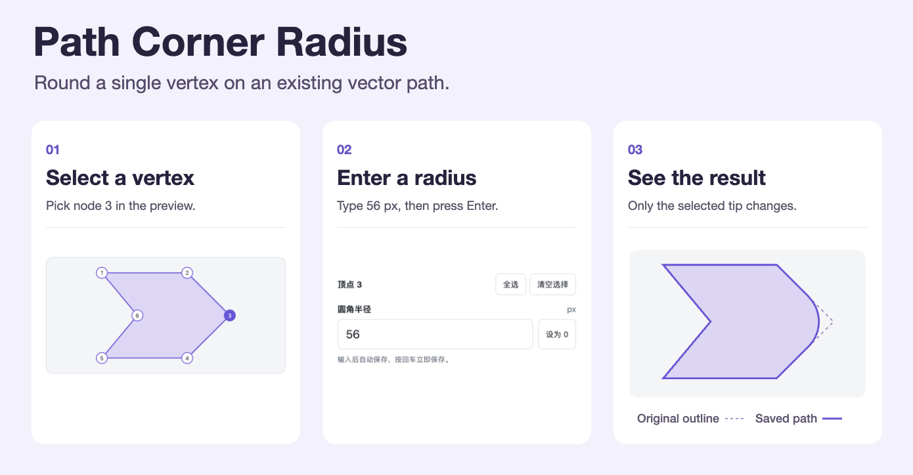
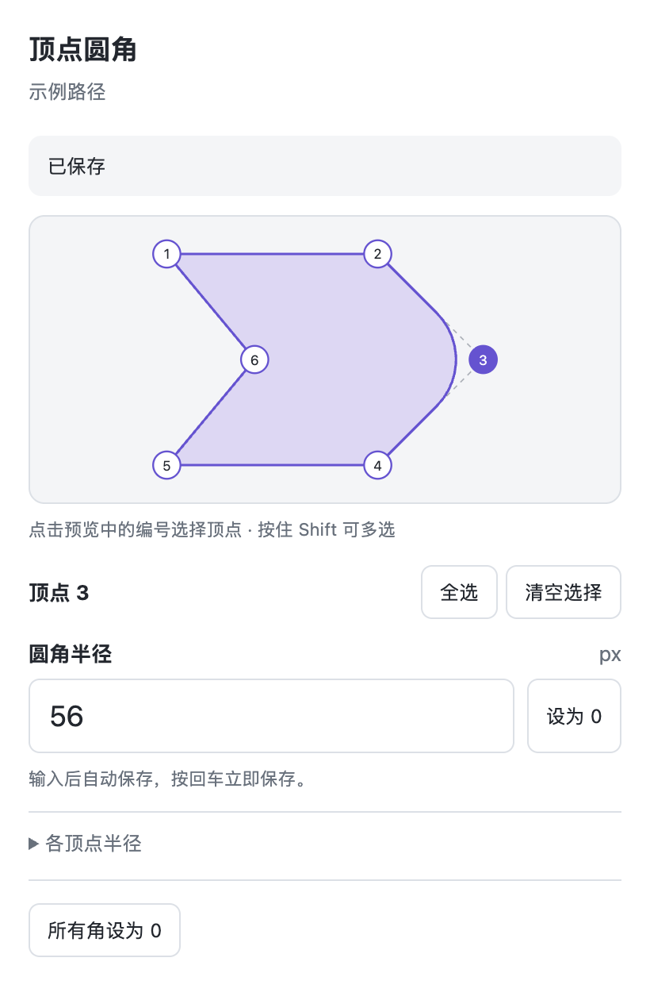

# Path Corner Radius · 顶点圆角

Change one corner of a vector path without rounding the others. Path Corner Radius also edits the native corners of rectangles and boards. The plugin interface is in Simplified Chinese.

## How to use · 使用方式

1. Select a path on the canvas and open **Path Corner Radius**. Click the numbered vertex you want to edit. Hold **Shift** to select several.
2. Type a radius in pixels. Press **Enter** to save immediately, or pause to let the plugin save automatically.
3. In the example, only vertex **3** changes from **0** to **56 px**. Enter **0** to restore a sharp corner, or use Penpot’s undo and redo.

选中路径并打开插件，在预览中点击要修改的编号，输入半径即可。图中只把第 3 个顶点从尖角改为半径 56 px 的圆角，其他顶点保留原状。

## Install

Open the plugin manager in the Penpot editor, paste the [manifest URL](https://tykevin.github.io/penpot-path-corner-radius/manifest.json) and choose **Install → Allow**. Open the plugin and select a shape on the canvas.

## Editing corners

- Rectangles and boards use native integer corner radii. Their children and layout are preserved.
- Vector paths support fractional radii on editable corners. The plugin can recognize some existing circular fillets on imported paths. Smooth nodes and open endpoints have no corner to round.
- Enter zero to restore a sharp corner. Oversized radii are limited by the available geometry.
- Use the layer selector to switch between editable shapes in a group.

## Data and permissions

The plugin uses `content:read` to inspect the selection and `content:write` to apply edits. For paths, it stores editable geometry on the shape in the Penpot document. The plugin has no analytics, external API calls, or service of its own. The browser requests the plugin’s static files from GitHub Pages.

## Development

With Node.js 20 or later, run `npm test` and then `npm run build`. The static plugin is built into `dist/`. GitHub Pages serves that directory after tests pass on the main branch.

Released under the [Mozilla Public License 2.0](LICENSE).
