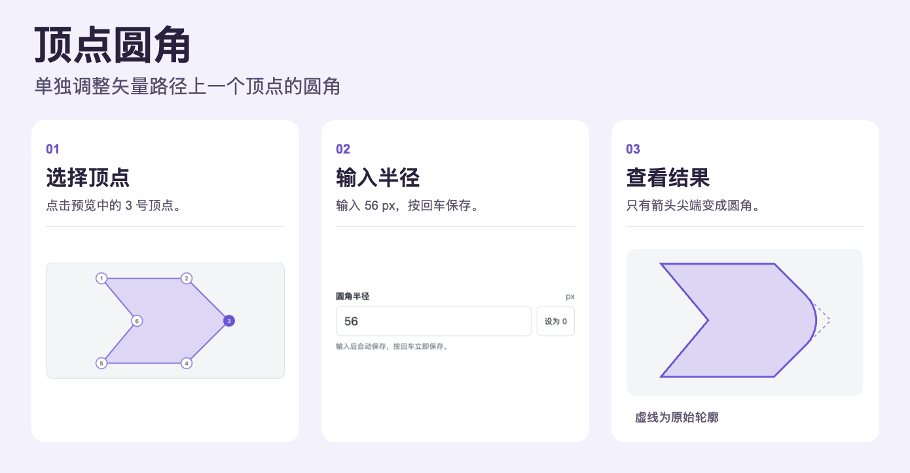
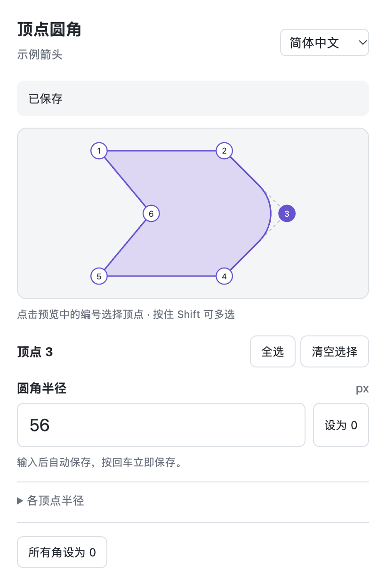

# 顶点圆角

[English](README.md) · 简体中文

在矢量路径上选择一个顶点，就能单独调整它的圆角。插件也支持矩形和画板的原生圆角。下图只将箭头尖端的半径从 0 改为 56 px，其余顶点保留原状。

## 安装

在 Penpot 编辑器打开 **Plugins（插件）**，粘贴[插件安装地址](https://tykevin.github.io/penpot-path-corner-radius/manifest.json)，依次点击 **Install → Allow**。打开「顶点圆角」，在画布上选中一个图形。

## 编辑圆角

1. 点击预览中带编号的顶点。按住 **Shift** 可以多选。选中组合时，可通过图层菜单切换目标形状。
2. 输入圆角半径，单位为像素。按 **Enter** 立即保存，也可以停止输入，等待自动保存。
3. 输入 **0** 可恢复尖角。Penpot 的撤销和重做同样适用于圆角编辑。

## 界面语言

插件会按浏览器的语言偏好选择简体中文或英文，其他语言默认显示英文。面板顶部可以选择 **English**、**简体中文** 或 **跟随浏览器**。浏览器允许本地存储时会记住选择。设计稿中的图层名称始终按原文显示。

## 支持的图形

- 矩形和画板使用原生整数半径，保留子图层和布局。
- 矢量路径上的转角支持小数半径，也能识别部分导入路径已有的圆弧。平滑节点和开放端点没有可倒圆的转角。
- 相邻边可能限制实际半径。面板会显示限制并保留输入值。

## 数据和权限

插件通过 `content:read` 读取选区，通过 `content:write` 应用编辑。可再次编辑的路径数据保存在 Penpot 文档的对应图层上。浏览器从 GitHub Pages 加载插件静态文件。插件没有统计追踪或外部 API 调用。

## 本地开发

使用 Node.js 20 或更高版本，运行 `npm test` 和 `npm run build`。主分支测试通过后，GitHub Pages 会部署 `dist/` 中的静态文件。

[Mozilla 公共许可证 2.0](LICENSE)
